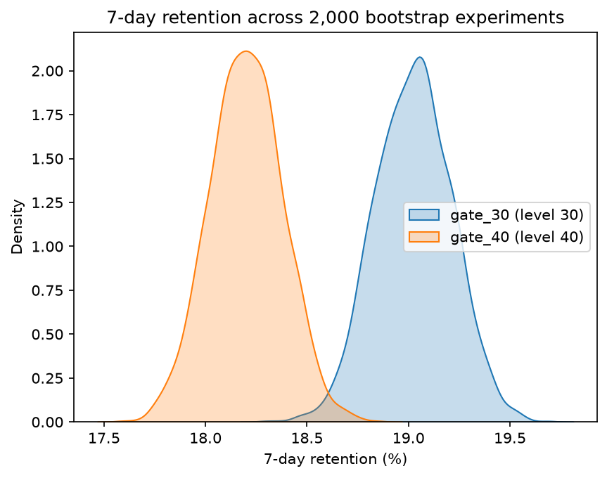
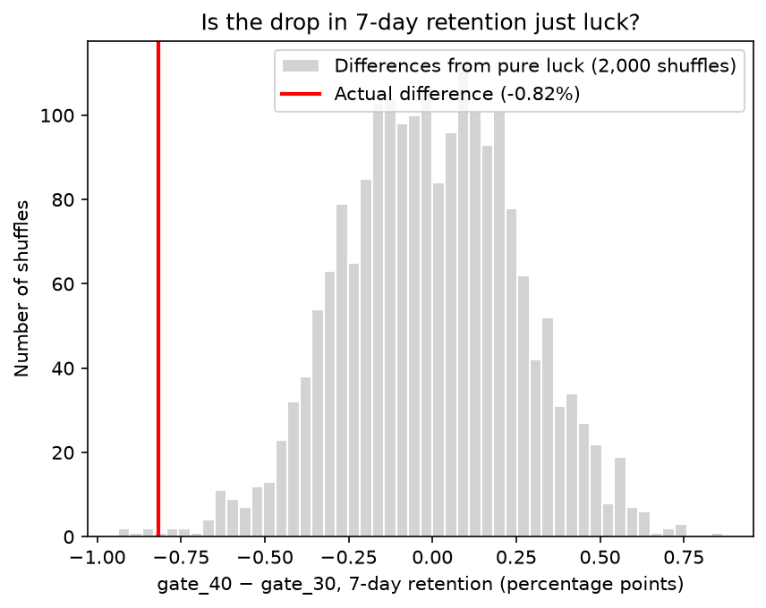
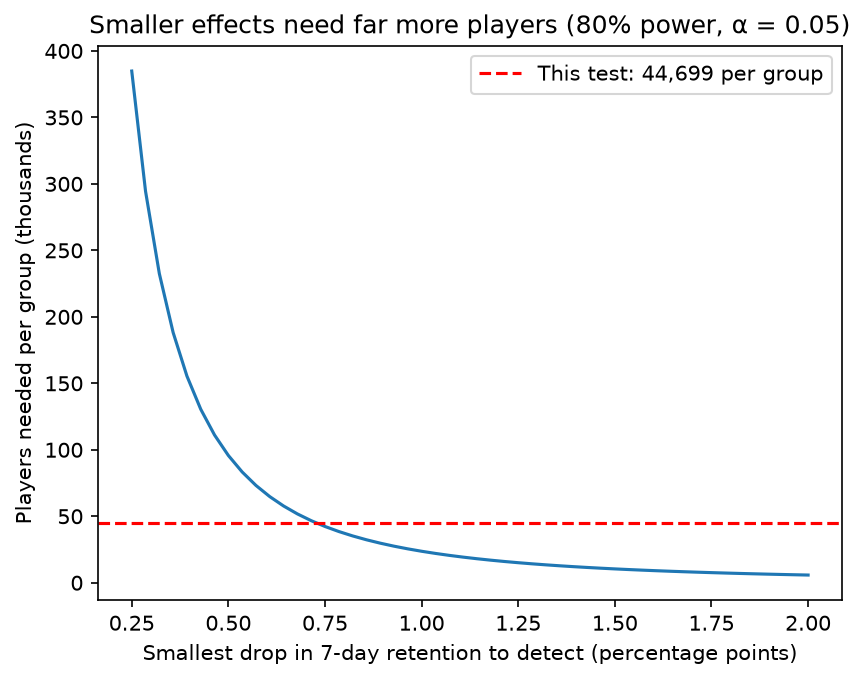

# 🧪 Cookie Cats A/B Test: Should the First Gate Move to Level 40?

Analysis of a mobile game A/B test with **90,188 players**. Players were randomly given the game's first gate (a forced pause) at **level 30** (control) or **level 40** (treatment). I tested whether moving the gate changes how many players come back after 1 and 7 days, using hypothesis tests, simulation and power analysis.

## Decision: keep the gate at level 30

Moving the gate to level 40 **significantly lowers 7-day retention**, by 0.82 percentage points (a 4.3% relative drop, about **820 fewer active players per 100,000 installs**). Two different methods agree, and the test had enough power to trust the result.



## Results

| Metric | gate_30 | gate_40 | Difference | 95% CI | p-value | Power |
|---|---|---|---|---|---|---|
| 1-day retention | 44.82% | 44.23% | −0.59 pts | [−1.24, +0.06] | 0.074 | 43% |
| **7-day retention** | **19.02%** | **18.20%** | **−0.82 pts** | **[−1.33, −0.31]** | **0.0016** | **88%** |

- **7-day retention:** significant with a two-proportion z-test (p = 0.0016) and a permutation test (p = 0.003). In a bootstrap of 2,000 resampled experiments, gate_30 retained more players **every time**.
- **1-day retention:** not significant, but the test only had **43% power** for an effect this small, so the result is **inconclusive**, not evidence of "no effect". Settling it would need about 111,000 players per group.
- **Why day 7 and not day 1?** The median player plays only 16 rounds, so most players haven't reached level 30 on day 1. Both groups have the same early experience; the gate matters later.

| Is it luck? (permutation test) | How many players does a test need? |
|---|---|
|  |  |

## Sanity checks before trusting the result

- **Sample ratio mismatch:** gate_40 has 45,489 players vs 44,700 for gate_30 (50.4% / 49.6%). A chi-square test gives **p = 0.009**, so the split is unlikely to be a fair 50/50. The imbalance is small, but it's a **limitation**; in a company I'd check the assignment process with engineering.
- **Outlier removed:** one player logged **49,854 rounds** in 14 days (the next highest was 2,961), almost certainly a bot or tracking error. Removing this single row made the groups' average rounds nearly identical (51.34 vs 51.30), as randomization should give.
- No duplicate players and no missing values.

## Recommendations

1. **Keep the first gate at level 30.**
2. **Investigate the sample ratio mismatch** before running the next experiment.
3. **Plan future tests with a power analysis:** to detect a 0.5-point change in 7-day retention, use about 96,000 players per group; halving the effect to detect roughly quadruples the sample needed.

## Approach

| Notebook | Methods |
|---|---|
| [01 Sanity checks](notebooks/01_explore_and_sanity_checks.ipynb) | Data quality, sample ratio mismatch (chi-square), outlier detection |
| [02 Hypothesis testing](notebooks/02_hypothesis_testing.ipynb) | Null/alternative hypotheses, permutation test, two-proportion z-test, confidence intervals |
| [03 Bootstrap](notebooks/03_bootstrap.ipynb) | 2,000 bootstrap resamples, percentile confidence intervals |
| [04 Power & sample size](notebooks/04_power_and_sample_size.ipynb) | Cohen's h, achieved power, minimum detectable effect, sample size planning |

**Tools:** Python · pandas · NumPy · SciPy · statsmodels · Matplotlib · seaborn

## How to run

1. Download `cookie_cats.csv` from the [Mobile Games A/B Testing dataset](https://www.kaggle.com/datasets/yufengsui/mobile-games-ab-testing) on Kaggle and put it in `data/`.
2. Set up the environment and run the notebooks in order:
   ```bash
   python -m venv .venv
   source .venv/bin/activate
   pip install -r requirements.txt
   ```
